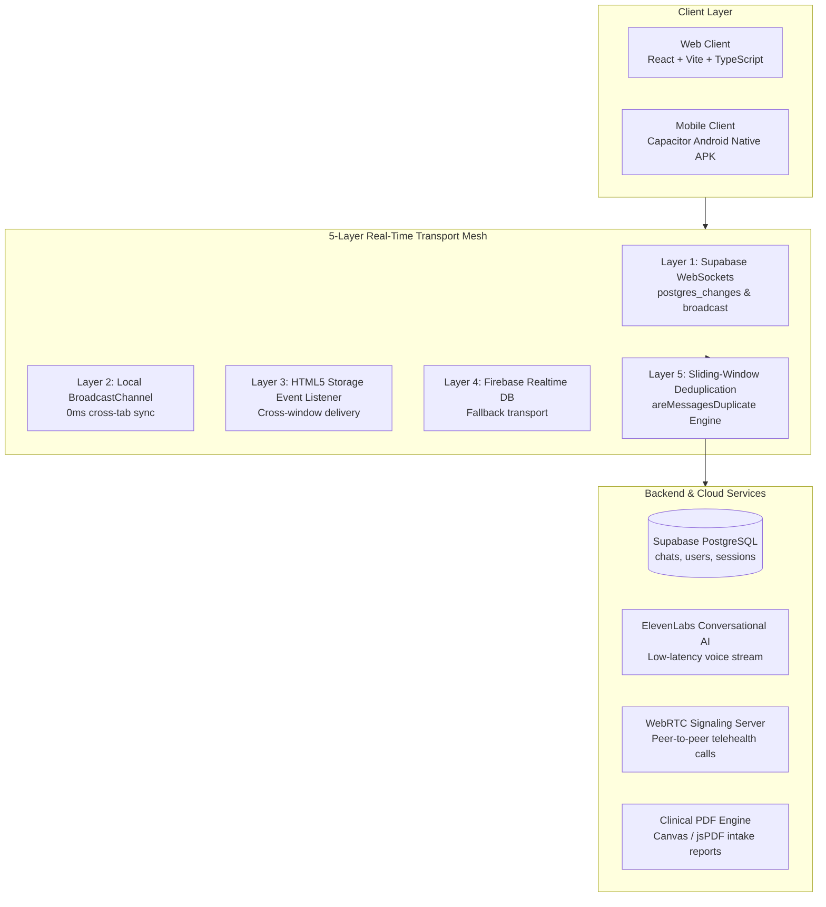

# ManoSakhi (मनोसखी) 🦋
### 24/7 Autonomous Empathetic Companion & Clinical Telehealth Tele-Consultation Platform

[](https://opensource.org/licenses/MIT)
[](https://www.typescriptlang.org/)
[](https://react.dev/)
[](https://tailwindcss.com/)
[](https://supabase.com/)
[](https://capacitorjs.com/)
[](#)

> **ManoSakhi** (meaning *"Friend of the Mind"*) is an AI-powered mental wellness ecosystem and clinical bridge designed for students, young adults, and campus communities. It pairs 24/7 empathetic conversational grounding, cognitive reframing, and reflective journaling with a real-time tele-consultation portal connecting individuals directly to licensed psychologists.

---

## 🌟 Overview & Key Highlights

- **24/7 Empathetic Conversational Companion (Asha)**: Real-time dialogue engine trained for active reflective listening, cognitive reframing, and somatic grounding (box breathing, sensory check-ins).
- **Dual-Persona Ecosystem**: 
  - **Student / User App**: Minimalist, private, zero-friction interface for mood tracking, guided journaling, sound therapy, and live consultations.
  - **Psychologist Workstation**: Clinical portal with patient triage, automated risk stratification (`CRITICAL`, `MODERATE`, `STABLE`), subchat archiving, and 1-click clinical PDF report synthesis.
- **Resilient 5-Layer Real-Time Transport Mesh**: High-speed bidirectional communication across Supabase WebSockets, PostgreSQL RLS, BroadcastChannel, HTML5 Storage events, and Firebase Realtime DB.
- **Zero-Latency Crisis Intervention**: Automated sentiment & intent recognition that immediately suppresses casual AI, injects an emergency modal, and surfaces direct 1-tap dialers for national hotlines (**Tele-MANAS `14416`**, **KIRAN `1800-599-0019`**).
- **Cross-Platform Native Mobile Delivery**: Built with Capacitor for seamless execution on Android with native haptics and offline-first asset caching.

---

## 🏗️ System Architecture



---

## 🚀 Features

### 1. Empathetic Conversational Support (Asha)
- Adaptive, non-judgmental conversational partner that validates emotions without toxic positivity.
- Naturalistic speech-to-speech audio streaming powered by ElevenLabs Conversational AI with sub-500ms time-to-first-audio.
- Interactive, inline breathing guides (Box Breathing, 4-7-8, Deep Calm).

### 2. Licensed Clinical Tele-Consultation Portal
- End-to-end encrypted direct 1-on-1 messaging between patients and therapists.
- Floating desktop notifications with instant reply support.
- Subchat branching for organizing conversations into Live Sessions, Intake History, and Treatment Notes.
- Integrated sound therapy dock with 432Hz ambient soundscapes for therapist relaxation.

### 3. Dynamic Mood & Emotion Analytics
- Multi-vector tracking (valence, arousal, stress, energy) visualised via interactive Recharts.
- Trigger identification correlating stressors with sleep, academics, and social dynamics.
- Longitudinal trends across 7-day, 30-day, and 90-day review windows.

### 4. Safety & Crisis Protection Protocol
- Deterministic regex & sentiment scanner evaluating every incoming message.
- 1-click crisis dialers:
  - **Tele-MANAS**: `14416`
  - **KIRAN Helpline**: `1800-599-0019`
  - **AASRA Suicide Prevention**: `+91-9820466726`
- Immediate clinical queue escalation with visual urgency badges.

### 5. Privacy & Data Ethics
- **Ephemeral Privacy Mode**: Instant client-side memory scrub ensuring no transcripts persist on disk.
- Fully compliant with zero-knowledge anonymity principles.

---

## 💻 Tech Stack

| Category | Technologies |
| :--- | :--- |
| **Frontend Framework** | React 18, TypeScript 5, Vite 7 |
| **Styling & Animation** | Tailwind CSS 3.4, Framer Motion, Lucide Icons |
| **Mobile Runtime** | Capacitor 8 (Android SDK 34, Native Haptics & App plugins) |
| **Primary Database** | Supabase PostgreSQL (Row-Level Security, Realtime channels) |
| **Fallback Transports** | BroadcastChannel API, HTML5 Storage Event, Firebase RTDB |
| **Voice & Media** | ElevenLabs Voice AI, WebRTC Peer-to-Peer Calling |
| **Data Visualization** | Recharts (Spline area charts, Radar charts, Bar breakdowns) |
| **Document Synthesis** | Custom Canvas / jsPDF Clinical Diagnostic Generator |

---

## 🛠️ Quick Start & Installation

### Prerequisites
- Node.js (v18.x or v20.x recommended)
- npm or yarn or pnpm
- (Optional) Android Studio & JDK 17+ for mobile APK builds

### 1. Clone the Repository
```bash
git clone https://github.com/your-username/manosakhi.git
cd manosakhi
```

### 2. Install Dependencies
```bash
npm install
```

### 3. Configure Environment Variables
Create a `.env` file in the root directory:

```env
# Supabase Configuration
VITE_SUPABASE_URL=https://your-project.supabase.co
VITE_SUPABASE_ANON_KEY=your-supabase-anon-key

# Firebase Fallback (Optional)
VITE_FIREBASE_API_KEY=your-firebase-api-key
VITE_FIREBASE_AUTH_DOMAIN=your-project.firebaseapp.com
VITE_FIREBASE_DATABASE_URL=https://your-project.firebaseio.com
VITE_FIREBASE_PROJECT_ID=your-project-id
VITE_FIREBASE_STORAGE_BUCKET=your-project.appspot.com
VITE_FIREBASE_MESSAGING_SENDER_ID=your-sender-id
VITE_FIREBASE_APP_ID=your-app-id

# Voice AI Configuration
VITE_ELEVENLABS_API_KEY=your-elevenlabs-api-key
VITE_ELEVENLABS_AGENT_ID=your-elevenlabs-agent-id
```

### 4. Start Local Development Server
```bash
npm run dev
```
Open [http://localhost:5173](http://localhost:5173) in your browser.

---

## 📱 Building the Mobile Android APK

ManoSakhi is configured with Capacitor to generate native Android builds.

```bash
# 1. Compile the production web bundle
npm run build

# 2. Sync web assets into Android project
npx cap sync android

# 3. Open in Android Studio to build APK or run on connected device
npx cap open android
```

---

## 🗄️ Database Schema (Supabase PostgreSQL)

ManoSakhi uses a relational schema with row-level security:

```sql
-- Clinical & Patient Direct Chat Table
CREATE TABLE chats (
  id BIGSERIAL PRIMARY KEY,
  client_id TEXT NOT NULL,
  role TEXT NOT NULL CHECK (role IN ('user', 'psych', 'ai', 'system')),
  content TEXT NOT NULL,
  msg_time TEXT,
  created_at TIMESTAMPTZ DEFAULT NOW()
);

-- Enable Realtime replication
ALTER PUBLICATION supabase_realtime ADD TABLE chats;
```

---

## 🛡️ Clinical & Safety Disclaimer

> **Important**: ManoSakhi is an empathetic AI wellness companion and tele-consultation facilitation tool. It is **not** a licensed medical diagnostic service or emergency psychiatric facility. Individuals in immediate crisis or experiencing suicidal ideation should contact their local emergency services or national crisis helplines immediately.

---

## 📄 License

Distributed under the MIT License. See `LICENSE` for details.

---

## 🤝 Acknowledgments & Credits

- **National Mental Health Programme (Tele-MANAS)** for emergency protocol guidelines.
- **ElevenLabs** for real-time naturalistic conversational speech synthesis.
- Built with care for student mental wellness.
